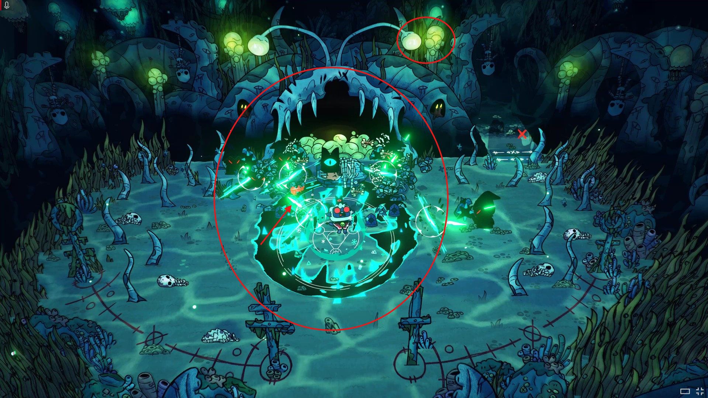
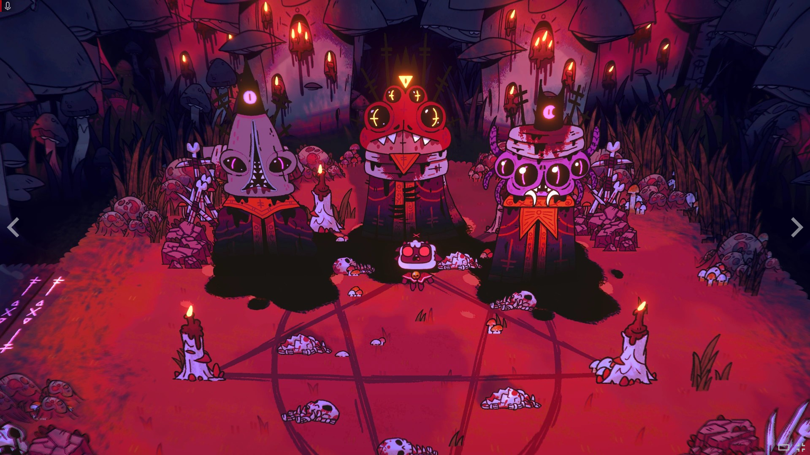

# Dirección visual: iluminación ambiental coloreada

**Proyecto:** DeadSingularity V1.

**Estado:** intención artística registrada el 17 de octubre de 2026; pendiente de implementación.

El creador del juego eligió las dos capturas incluidas de Cult of the Lamb por su iluminación y atmósfera. Este documento y sus imágenes deben permitir retomar la idea sin acceso a la conversación original. En esta etapa se conserva la referencia; implementar cambios de iluminación requiere una petición posterior.

## Lo que busca

- Fuentes que se perciban claramente encendidas por su color y luminosidad: centro brillante, transición de color hacia afuera y resplandor suave alrededor.
- Luz coloreada que afecte visualmente las superficies y zonas cercanas, integrando la fuente con el entorno.
- En ciertas escenas, una iluminación que invada gran parte del ambiente y lo tiña de una misma familia cromática, conservando contraste y detalle.
- Una atmósfera coherente que una personajes, objetos y escenario mediante el color de la luz.
- Llevar esta dirección en el futuro a todo el juego; un probable primer destino son los fondos o campos de batalla espaciales.

## Lectura de las capturas

**Referencia verde/cian:** fuentes verdosas luminosas sobre un ambiente azul oscuro. Los centros claros y los resplandores locales hacen legible la emisión. En el área central, la luz verde/cian ocupa una región mayor y domina visualmente sus alrededores. Las zonas alejadas y los bordes oscuros mantienen profundidad y contraste.

**Referencia roja/magenta:** velas con centros cálidos brillantes y un ambiente ampliamente teñido de rojo, rosa y violeta. Suelo, elementos y figuras se sienten integrados en esa atmósfera, mientras permanecen áreas oscuras y puntos de brillo que ordenan la escena.

Estas son observaciones del resultado visual. Las capturas no permiten determinar qué técnica de motor usa el juego ni separar con certeza iluminación dinámica, color pintado, posprocesado o sus combinaciones.

## Criterio para una futura implementación

La referencia principal es que **la luz colorea e integra el ambiente**, además de hacer brillar su fuente. Elegir la técnica después de estudiar el render actual del proyecto. Evaluar también legibilidad de enemigos, proyectiles y señales de peligro en combate concurrido; conservar las identidades cromáticas de los nueve enemigos aprobados.

No confundir este objetivo con los halos circulares decorativos de élites o la estela del Enjambrito que el usuario pidió retirar. Esas eliminaciones siguen vigentes.

Las referencias son exclusivamente de iluminación y atmósfera: no son un pedido de copiar criaturas, escenarios, interfaz, perspectiva o mecánicas de Cult of the Lamb.

## Archivos de referencia

Las capturas originales se conservan sin modificaciones junto a este documento; no dependen de enlaces externos ni archivos temporales. Las flechas y círculos rojos de la primera son anotaciones del creador para señalar las zonas de interés.

### Verde/cian: emisión local y luz sobre el entorno

### Rojo/magenta: atmósfera que domina el ambiente

Estado: referencia recibida y guardada. Implementación futura, cuando el usuario la solicite.

## Primera aplicación: núcleos de enemigos

Se implementó una primera etapa limitada a los nueve núcleos de la familia marfil: [cadencias, señales y rendimiento](../NUCLEOS_ILUMINACION_V1.md). La iluminación de fondos y ambiente global sigue pendiente. Las capturas originales y la intención de esta referencia permanecen vigentes.
